# Crate map

Every crate in the `rust-broadcast` workspace: what it does, which standards it
implements, whether it is `no_std`, whether it is on crates.io, and what it
depends on. For the per-standard view (which crate implements ETSI EN 300 468,
RFC 3550, SMPTE ST 337, ...) see [STANDARDS.md](STANDARDS.md). For the rules
each crate's own README follows, see [DOC-STANDARD.md](DOC-STANDARD.md).

The part of this page between the `GENERATED` markers is produced by
[`tools/gen-crate-index.py`](../tools/gen-crate-index.py) from each crate's
`Cargo.toml`, the `no_std` build list in `.github/workflows/ci.yml`, and the
editorial fields in [`crates-index.toml`](crates-index.toml). CI runs
`python3 tools/gen-crate-index.py --check`, so the tables cannot drift from the
code. To change a description, edit `crates-index.toml` (or the crate's
`Cargo.toml`) and re-run the generator; do not edit the generated block by hand.

## Which crate do I use?

| I want to ... | Start with | Then |
|---|---|---|
| Read DVB service information (services, EPG, NIT, PMT) from a `.ts` file | [`dvb-si`](#dvb-si) (`SiDemux`) | [`dvb-tools`](#dvb-tools) for a ready-made CLI |
| Split a transport stream into packets / PSI sections myself | [`mpeg-ts`](#mpeg-ts) | [`mpeg-pes`](#mpeg-pes) for PES and PTS/DTS |
| Decode a DVB-T2 modulator feed (T2-MI) down to the inner TS | [`dvb-t2mi`](#dvb-t2mi) | [`dvb-bbframe`](#dvb-bbframe), then [`dvb-si`](#dvb-si) |
| Read DVB-S2/S2X baseband frames | [`dvb-bbframe`](#dvb-bbframe) | |
| Read or write a Program Stream (`.mpg`, `.vob`) | [`mpeg-ps`](#mpeg-ps) | [`transmux`](#transmux) to remux it |
| Work out what container a file is | [`container-probe`](#container-probe) | |
| Remux between TS, fMP4/CMAF, MP4, PS, WebM, FLV | [`transmux`](#transmux) | |
| Package to HLS, LL-HLS, DASH, LL-DASH or Smooth | [`transmux`](#transmux) (segmenters) | [`broadcast-hls`](#broadcast-hls) for playlist syntax only |
| Parse or write an `.m3u8` playlist | [`broadcast-hls`](#broadcast-hls) | |
| Encrypt or decrypt CENC/CBCS content | [`transmux`](#transmux) (`cenc` feature) | |
| Run a live origin: ingest RTSP/SRT/RTMP/TS/HLS and serve LL-HLS/DASH | [`multimux`](#multimux) or the [`multimux-cli`](#multimux-cli) binary | [`media-plane`](#media-plane) if you are building your own |
| Speak RTSP as a client or server | [`rtsp-runtime`](#rtsp-runtime) | [`rtp-packet`](#rtp-packet), [`rtcp-packet`](#rtcp-packet) |
| Accept an RTMP publish | [`rtmp-runtime`](#rtmp-runtime) | |
| Send or receive SRT | [`srt-runtime`](#srt-runtime) | |
| Pull LL-HLS, or serve it from your own server | [`hls-runtime`](#hls-runtime) | |
| WHIP ingest / WHEP playback signalling | [`webrtc-runtime`](#webrtc-runtime) | |
| Check a stream against ETSI TR 101 290 | [`dvb-conformance`](#dvb-conformance) | [`compliance-probe`](#compliance-probe) for a live metrics exporter |
| Lint a TS / HLS / DASH / CMAF asset | [`media-doctor`](#media-doctor) | |
| Repair a broken TS (continuity, PCR, PAT/PMT) | [`ts-fix`](#ts-fix) | |
| Parse or build SCTE 35 ad cues | [`scte35-splice`](#scte35-splice) | [`timed-metadata`](#timed-metadata) to carry them in HLS/DASH |
| Handle SCTE 104 from automation | [`scte104`](#scte104) | |
| Server-side ad insertion | [`ssai-runtime`](#ssai-runtime) | [`timed-metadata`](#timed-metadata), [`scte35-splice`](#scte35-splice) |
| Build a linear channel from a schedule | [`playout-runtime`](#playout-runtime) | |
| Extract CEA-608/708 captions | [`cc-data`](#cc-data) | [`caption-convert`](#caption-convert) to get WebVTT/SRT |
| Read DVB bitmap subtitles | [`dvb-subtitle`](#dvb-subtitle) | |
| Read teletext, VPS or WSS from a DVB stream | [`dvb-vbi`](#dvb-vbi) | [`caption-convert`](#caption-convert) for teletext subtitles |
| Parse or validate TTML / IMSC | [`ttml-subtitle`](#ttml-subtitle) | |
| Talk to a CAM over the Common Interface | [`dvb-ci-runtime`](#dvb-ci-runtime) | [`dvb-ci`](#dvb-ci) for the wire codecs |
| Scramble or descramble with DVB-CSA | [`dvb-csa`](#dvb-csa) | |
| Speak the SimulCrypt head-end protocol | [`dvb-simulcrypt`](#dvb-simulcrypt) | |
| Measure loudness (LUFS, LRA, true peak) | [`broadcast-loudness`](#broadcast-loudness) | |
| Read MXF | [`st377-1`](#st377-1) | |
| SDI ancillary data, LTC timecode, AES3 non-PCM, Dolby Atmos | [`st291`](#st291), [`st12-1`](#st12-1), [`st337`](#st337), [`rdd29`](#rdd29) | |
| IP over TS (ULE), multicast file delivery (FLUTE/ALC/NORM) | [`ule`](#ule), [`rmt-flute`](#rmt-flute) | [`dvb-mabr`](#dvb-mabr) for DVB-MABR session config |

## Outside the workspace

### Python bindings

Both live under [`bindings/`](../bindings/), are **not** workspace members
(they have their own MSRV and `Cargo.lock`) and depend on the *published*
crates by version, not by path.

| Package | What it does | Depends on (crates.io) | PyPI |
|---|---|---|---|
| [`dvb-si-py`](../bindings/python/) | PyO3/maturin bindings: `parse_section(bytes) -> dict`, plus `Demux` and `T2miDemux` classes. Read-only: parse, then serde JSON, then Python objects. | `dvb-si` 9, `dvb-t2mi` 9 | not found on PyPI under this name (checked 2026-10-16) |
| [`transmux-py`](../bindings/transmux-py/) | PyO3/maturin bindings: `demux_ts(bytes) -> dict` exposing the `Media`/`Track`/`Sample` IR for ML and analysis front ends. | `transmux` 0.21, `broadcast-common` 9 | not found on PyPI under this name (checked 2026-10-16) |

Both pin older majors of their Rust dependencies than the workspace currently
builds (see the table above against the in-tree versions below).

### Docs-only directories

[`cpix/`](../cpix/) and [`st2110/`](../st2110/) are **not crates**: no
`Cargo.toml`, no `src/`, not workspace members, never published. Each holds a
`docs/` tree of spec transcriptions so a future crate has cited groundwork:

- `cpix/docs/` — DASH-IF CPIX 2.3 and the SPEKE API (DRM key exchange).
- `st2110/docs/` — SMPTE ST 2110-20 (video), -21 (traffic shaping), -30 (audio).

### Renamed crates

The workspace does not publish re-export shims. When a crate is renamed, the
old name's versions are yanked so a stale `Cargo.toml` fails loudly:
`dvb-flute` -> `rmt-flute`, `smpte2038` and `dvb-smpte2038` -> `st291`. The
exception is `ll-hls-runtime` -> `hls-runtime`: the rename tracked a scope
change, so the old versions stay live.

## The crates

<!-- BEGIN GENERATED: crate-index (tools/gen-crate-index.py) -->
**61 workspace members.** 55 are on crates.io; 48 are proven `no_std` by CI (built with `--no-default-features` for `thumbv7em-none-eabi`). Versions below are the **in-tree** versions on this branch; the badge shows what crates.io currently serves.

### Overview

| Crate | Domain | In-tree version | crates.io | `no_std` (CI) | Layer | Status |
|---|---|---|---|---|---|---|
| [`broadcast-auth`](#broadcast-auth) | Foundation | 0.5.0 | [](https://crates.io/crates/broadcast-auth) | no | 0 | on crates.io |
| [`broadcast-common`](#broadcast-common) | Foundation | 10.0.0 | [](https://crates.io/crates/broadcast-common) | yes | 0 | on crates.io |
| [`mpeg-pes`](#mpeg-pes) | MPEG-2 TS / PES / PS framing | 0.6.0 | [](https://crates.io/crates/mpeg-pes) | yes | 1 | on crates.io |
| [`mpeg-ts`](#mpeg-ts) | MPEG-2 TS / PES / PS framing | 0.6.2 | [](https://crates.io/crates/mpeg-ts) | yes | 1 | on crates.io |
| [`mpeg-ps`](#mpeg-ps) | MPEG-2 TS / PES / PS framing | 0.6.0 | [](https://crates.io/crates/mpeg-ps) | yes | 2 | on crates.io |
| [`dvb-stream`](#dvb-stream) | MPEG-2 TS / PES / PS framing | 0.7.0 | [](https://crates.io/crates/dvb-stream) | no | 3 | on crates.io |
| [`dvb-bbframe`](#dvb-bbframe) | DVB service information, physical-layer framing and conformance | 12.0.0 | [](https://crates.io/crates/dvb-bbframe) | yes | 1 | on crates.io |
| [`dvb-si`](#dvb-si) | DVB service information, physical-layer framing and conformance | 12.0.0 | [](https://crates.io/crates/dvb-si) | yes | 2 | on crates.io |
| [`dvb-t2mi`](#dvb-t2mi) | DVB service information, physical-layer framing and conformance | 12.0.0 | [](https://crates.io/crates/dvb-t2mi) | yes | 2 | on crates.io |
| [`dvb-conformance`](#dvb-conformance) | DVB service information, physical-layer framing and conformance | 12.0.0 | [](https://crates.io/crates/dvb-conformance) | yes | 3 | on crates.io |
| [`dvb-simulcrypt`](#dvb-simulcrypt) | Common Interface, conditional access, scrambling, SimulCrypt | 0.7.0 | [](https://crates.io/crates/dvb-simulcrypt) | yes | 1 | on crates.io |
| [`dvb-csa`](#dvb-csa) | Common Interface, conditional access, scrambling, SimulCrypt | 0.4.0 | [](https://crates.io/crates/dvb-csa) | yes | 2 | on crates.io |
| [`dvb-ci`](#dvb-ci) | Common Interface, conditional access, scrambling, SimulCrypt | 0.10.0 | [](https://crates.io/crates/dvb-ci) | yes | 3 | on crates.io |
| [`dvb-ci-runtime`](#dvb-ci-runtime) | Common Interface, conditional access, scrambling, SimulCrypt | 0.18.1 | [](https://crates.io/crates/dvb-ci-runtime) | no | 4 | on crates.io |
| [`cc-data`](#cc-data) | Subtitles, captions, teletext, VBI and ancillary data | 0.7.0 | [](https://crates.io/crates/cc-data) | yes | 1 | on crates.io |
| [`dvb-subtitle`](#dvb-subtitle) | Subtitles, captions, teletext, VBI and ancillary data | 0.6.0 | [](https://crates.io/crates/dvb-subtitle) | yes | 1 | on crates.io |
| [`dvb-vbi`](#dvb-vbi) | Subtitles, captions, teletext, VBI and ancillary data | 0.5.0 | [](https://crates.io/crates/dvb-vbi) | yes | 1 | on crates.io |
| [`ttml-subtitle`](#ttml-subtitle) | Subtitles, captions, teletext, VBI and ancillary data | 0.4.0 | [](https://crates.io/crates/ttml-subtitle) | yes | 1 | on crates.io |
| [`st291`](#st291) | Subtitles, captions, teletext, VBI and ancillary data | 0.5.0 | [](https://crates.io/crates/st291) | yes | 2 | on crates.io |
| [`caption-convert`](#caption-convert) | Subtitles, captions, teletext, VBI and ancillary data | 0.3.0 | [](https://crates.io/crates/caption-convert) | yes | 3 | on crates.io |
| [`mp4-emsg`](#mp4-emsg) | Metadata and ad-insertion signalling | 0.5.0 | [](https://crates.io/crates/mp4-emsg) | yes | 1 | on crates.io |
| [`scte104`](#scte104) | Metadata and ad-insertion signalling | 0.6.0 | [](https://crates.io/crates/scte104) | yes | 1 | on crates.io |
| [`scte35-splice`](#scte35-splice) | Metadata and ad-insertion signalling | 4.0.0 | [](https://crates.io/crates/scte35-splice) | yes | 1 | on crates.io |
| [`timed-metadata`](#timed-metadata) | Metadata and ad-insertion signalling | 0.7.0 | [](https://crates.io/crates/timed-metadata) | yes | 2 | on crates.io |
| [`broadcast-hls`](#broadcast-hls) | Containers and adaptive streaming | 0.4.0 | [](https://crates.io/crates/broadcast-hls) | yes | 1 | on crates.io |
| [`container-probe`](#container-probe) | Containers and adaptive streaming | 0.2.0 | [](https://crates.io/crates/container-probe) | yes | 1 | on crates.io |
| [`transmux`](#transmux) | Containers and adaptive streaming | 0.27.7 | [](https://crates.io/crates/transmux) | yes | 3 | on crates.io |
| [`buffering-runtime`](#buffering-runtime) | Live transport protocols | 0.1.0 | [](https://crates.io/crates/buffering-runtime) | yes | 1 | on crates.io |
| [`rtcp-packet`](#rtcp-packet) | Live transport protocols | 0.6.0 | [](https://crates.io/crates/rtcp-packet) | yes | 1 | on crates.io |
| [`rtmp-runtime`](#rtmp-runtime) | Live transport protocols | 0.8.0 | [](https://crates.io/crates/rtmp-runtime) | no | 1 | on crates.io |
| [`rtp-packet`](#rtp-packet) | Live transport protocols | 0.5.0 | [](https://crates.io/crates/rtp-packet) | yes | 1 | on crates.io |
| [`rtsp-runtime`](#rtsp-runtime) | Live transport protocols | 0.8.0 | [](https://crates.io/crates/rtsp-runtime) | no | 1 | on crates.io |
| [`srt-runtime`](#srt-runtime) | Live transport protocols | 0.6.0 | [](https://crates.io/crates/srt-runtime) | yes | 1 | on crates.io |
| [`st2022`](#st2022) | Live transport protocols | 0.2.0 | [](https://crates.io/crates/st2022) | yes | 1 | on crates.io |
| [`rist-runtime`](#rist-runtime) | Live transport protocols | 0.4.0 | [](https://crates.io/crates/rist-runtime) | yes | 2 | on crates.io |
| [`webrtc-runtime`](#webrtc-runtime) | Live transport protocols | 0.4.0 | [](https://crates.io/crates/webrtc-runtime) | no | 2 | on crates.io |
| [`tshttp-runtime`](#tshttp-runtime) | Live transport protocols | 0.1.0 | — | yes | 4 | not on crates.io |
| [`hls-runtime`](#hls-runtime) | Live transport protocols | 0.9.0 | [](https://crates.io/crates/hls-runtime) | yes | 5 | on crates.io |
| [`broadcast-client`](#broadcast-client) | Live transport protocols | 0.1.0 | — | no | 6 | not on crates.io |
| [`ssai-runtime`](#ssai-runtime) | Servers, runtimes and tools | 0.3.0 | [](https://crates.io/crates/ssai-runtime) | yes | 2 | on crates.io |
| [`dvb-tools`](#dvb-tools) | Servers, runtimes and tools | 12.0.0 | [](https://crates.io/crates/dvb-tools) | no | 3 | on crates.io |
| [`playout-runtime`](#playout-runtime) | Servers, runtimes and tools | 0.3.0 | [](https://crates.io/crates/playout-runtime) | yes | 3 | on crates.io |
| [`media-doctor`](#media-doctor) | Servers, runtimes and tools | 0.11.0 | [](https://crates.io/crates/media-doctor) | yes | 4 | on crates.io |
| [`media-plane`](#media-plane) | Servers, runtimes and tools | 0.7.0 | [](https://crates.io/crates/media-plane) | yes | 4 | on crates.io |
| [`ts-fix`](#ts-fix) | Servers, runtimes and tools | 0.7.0 | [](https://crates.io/crates/ts-fix) | yes | 4 | on crates.io |
| [`compliance-probe`](#compliance-probe) | Servers, runtimes and tools | 0.4.0 | [](https://crates.io/crates/compliance-probe) | yes | 5 | on crates.io |
| [`multimux`](#multimux) | Servers, runtimes and tools | 0.13.0 | [](https://crates.io/crates/multimux) | no | 6 | on crates.io |
| [`multimux-cli`](#multimux-cli) | Servers, runtimes and tools | 0.11.0 | [](https://crates.io/crates/multimux-cli) | no | 7 | on crates.io |
| [`rdd29`](#rdd29) | Professional media (SMPTE / AES / Dolby) | 0.5.0 | [](https://crates.io/crates/rdd29) | yes | 1 | on crates.io |
| [`st12-1`](#st12-1) | Professional media (SMPTE / AES / Dolby) | 0.4.0 | [](https://crates.io/crates/st12-1) | yes | 1 | on crates.io |
| [`st337`](#st337) | Professional media (SMPTE / AES / Dolby) | 0.4.0 | [](https://crates.io/crates/st337) | yes | 1 | on crates.io |
| [`st377-1`](#st377-1) | Professional media (SMPTE / AES / Dolby) | 0.5.0 | [](https://crates.io/crates/st377-1) | yes | 1 | on crates.io |
| [`atsc3`](#atsc3) | IP and multicast delivery over broadcast | 0.1.0 | — | yes | 1 | archived, never published |
| [`dvb-mabr`](#dvb-mabr) | IP and multicast delivery over broadcast | 0.3.0 | [](https://crates.io/crates/dvb-mabr) | yes | 1 | on crates.io |
| [`rmt-flute`](#rmt-flute) | IP and multicast delivery over broadcast | 0.7.0 | [](https://crates.io/crates/rmt-flute) | yes | 1 | on crates.io |
| [`ule`](#ule) | IP and multicast delivery over broadcast | 0.5.0 | [](https://crates.io/crates/ule) | yes | 1 | on crates.io |
| [`atsc3-route`](#atsc3-route) | IP and multicast delivery over broadcast | 0.3.0 | [](https://crates.io/crates/atsc3-route) | yes | 2 | archived, on crates.io |
| [`broadcast-loudness`](#broadcast-loudness) | Measurement | 0.5.0 | [](https://crates.io/crates/broadcast-loudness) | yes | 1 | on crates.io |
| [`test-alloc`](#test-alloc) | Internal test helpers (never published) | 0.1.0 | — | no | 0 | internal, `publish = false` |
| [`test-bounded`](#test-bounded) | Internal test helpers (never published) | 0.1.0 | — | no | 0 | internal, `publish = false` |
| [`test-fixtures`](#test-fixtures) | Internal test helpers (never published) | 0.1.0 | — | no | 0 | internal, `publish = false` |

### Foundation

Shared traits and helpers every other crate builds on.

#### broadcast-auth

One credentials model and one challenge-response helper for clients, plus one server-side `Verifier` (including a reverse-proxy `forwarded` scheme), used by `rtsp-runtime`, `hls-runtime` and `multimux`. Basic/Digest challenge parsing is delegated to the `http-auth` crate.

- **Standards:** RFC 7235, RFC 7616 / RFC 2617 (Digest), RFC 6750 (Bearer), RFC 2326 §14
- **Cargo description:** Shared multi-scheme HTTP/RTSP auth: Basic/Digest (RFC 7235, RFC 2326 §14) via http-auth, Bearer (RFC 6750); one Credentials model + challenge->response helper for rtsp-runtime and multimux's HTTP clients.
- **Version (in-tree):** 0.5.0 · **Status:** on crates.io · **`no_std` proven in CI:** no · **Layer:** 0
- **Depends on (workspace):** none
- **Used by (workspace):** [`broadcast-client`](#broadcast-client), [`hls-runtime`](#hls-runtime), [`multimux`](#multimux), [`rtsp-runtime`](#rtsp-runtime)
- **Links:** [README](../broadcast-auth/README.md) · [CHANGELOG](../broadcast-auth/CHANGELOG.md) · [spec transcriptions](../broadcast-auth/docs/) · [crates.io](https://crates.io/crates/broadcast-auth) · [docs.rs](https://docs.rs/broadcast-auth)

#### broadcast-common

The base of the workspace: the zero-copy `Parse<'a>` / `Serialize` trait pair every wire type implements, the MPEG-2 CRC-32, BCD/MJD time and hex codecs, range-checked length narrowing for serializers (`len`), the container `mux` traits, the `cenc::CencScheme` identity shared by `transmux` and `broadcast-hls`, and `clock33` wrapping 33-bit PTS/DTS arithmetic. It implements no protocol on its own. Versioned independently of the DVB lockstep.

- **Standards:** ISO/IEC 13818-1 CRC-32 (Annex A); ISO/IEC 23001-7 scheme identity (`cenc`)
- **Cargo description:** Foundation for the rust-broadcast crates: symmetric Parse/Serialize traits, CRC-32/MPEG-2, BCD + MJD time codecs, bit I/O, 33-bit/PCR clock arithmetic, checked field widths, container-mux and Stage traits. no_std + alloc.
- **Version (in-tree):** 10.0.0 · **Status:** on crates.io · **`no_std` proven in CI:** yes · **Layer:** 0
- **Depends on (workspace):** none
- **Used by (workspace):** 53 workspace crates
- **Links:** [README](../broadcast-common/README.md) · [CHANGELOG](../broadcast-common/CHANGELOG.md) · [crates.io](https://crates.io/crates/broadcast-common) · [docs.rs](https://docs.rs/broadcast-common)

### MPEG-2 TS / PES / PS framing

The MPEG-2 systems layer (ISO/IEC 13818-1 / ITU-T H.222.0) and async adapters over it.

#### mpeg-pes

The layer between TS packets and elementary streams: PES packet header parse/serialize, the `stream_id` registry (including the AVS3 extended stream ids from T/AI 109.6 / 109.7), 33-bit 90 kHz `Pts`/`Dts`, and a per-PID assembler. Elementary-stream payloads stay opaque.

- **Standards:** ISO/IEC 13818-1:2021 (ITU-T H.222.0 06/2021) §2.4.3.6-§2.4.3.7
- **Cargo description:** PES (Packetized Elementary Stream) depacketization + PTS/DTS — ISO/IEC 13818-1 §2.4.3.
- **Version (in-tree):** 0.6.0 · **Status:** on crates.io · **`no_std` proven in CI:** yes · **Layer:** 1
- **Depends on (workspace):** [`broadcast-common`](#broadcast-common)
- **Used by (workspace):** [`media-doctor`](#media-doctor), [`mpeg-ps`](#mpeg-ps), [`transmux`](#transmux), [`ts-fix`](#ts-fix)
- **Links:** [README](../mpeg-pes/README.md) · [CHANGELOG](../mpeg-pes/CHANGELOG.md) · [spec transcriptions](../mpeg-pes/docs/) · [crates.io](https://crates.io/crates/mpeg-pes) · [docs.rs](https://docs.rs/mpeg-pes)

#### mpeg-ts

Generic MPEG-2 Transport Stream framing: zero-copy and owned 188-byte packets, the adaptation field and PCR, PSI section reassembly and packetisation, byte-stream resynchronisation, and a scheduler-mux for SI tables. `dvb-si` and most TS-handling crates use it for the packet layer. It does not parse table bodies (that is `dvb-si`) or PES (that is `mpeg-pes`).

- **Standards:** ITU-T H.222.0 (08/2023) = ISO/IEC 13818-1 §2.4.3, §2.4.4
- **Cargo description:** MPEG-2 Transport Stream framing (ITU-T H.222.0 / ISO/IEC 13818-1): TS packet, adaptation field, PCR, PSI section reassembly + packetisation, resync. no_std.
- **Version (in-tree):** 0.6.2 · **Status:** on crates.io · **`no_std` proven in CI:** yes · **Layer:** 1
- **Depends on (workspace):** [`broadcast-common`](#broadcast-common)
- **Used by (workspace):** [`broadcast-client`](#broadcast-client), [`compliance-probe`](#compliance-probe), [`dvb-ci`](#dvb-ci), [`dvb-ci-runtime`](#dvb-ci-runtime), [`dvb-conformance`](#dvb-conformance), [`dvb-csa`](#dvb-csa), [`dvb-si`](#dvb-si), [`dvb-stream`](#dvb-stream), [`dvb-t2mi`](#dvb-t2mi), [`dvb-tools`](#dvb-tools), [`media-doctor`](#media-doctor), [`multimux`](#multimux), [`transmux`](#transmux), [`ts-fix`](#ts-fix)
- **Links:** [README](../mpeg-ts/README.md) · [CHANGELOG](../mpeg-ts/CHANGELOG.md) · [spec transcriptions](../mpeg-ts/docs/) · [crates.io](https://crates.io/crates/mpeg-ts) · [docs.rs](https://docs.rs/mpeg-ts)

#### mpeg-ps

Program Stream (`.mpg` / `.vob`) framing around PES packets. Only the MPEG-2 pack layout is implemented; an MPEG-1 (ISO/IEC 11172-1) pack is recognised and rejected with `Error::Mpeg1NotSupported` rather than misparsed.

- **Standards:** ISO/IEC 13818-1:2021 §2.5
- **Cargo description:** MPEG-2 Program Stream parser — pack header, system header, program stream map (ISO/IEC 13818-1 §2.5).
- **Version (in-tree):** 0.6.0 · **Status:** on crates.io · **`no_std` proven in CI:** yes · **Layer:** 2
- **Depends on (workspace):** [`broadcast-common`](#broadcast-common), [`mpeg-pes`](#mpeg-pes)
- **Used by (workspace):** [`transmux`](#transmux)
- **Links:** [README](../mpeg-ps/README.md) · [CHANGELOG](../mpeg-ps/CHANGELOG.md) · [spec transcriptions](../mpeg-ps/docs/) · [crates.io](https://crates.io/crates/mpeg-ps) · [docs.rs](https://docs.rs/mpeg-ps)

#### dvb-stream

Wraps the synchronous `SiDemux` and `T2miPump` as `futures::Stream`s over any `AsyncRead`, and provides TS framing as a `tokio_util` codec plus UDP/multicast receive (socket options through `socket2`). Keeps tokio out of the parser crates. Requires `std`.

- **Standards:** none of its own (adapters over dvb-si / dvb-t2mi); RFC 3550 RTP unwrapping via rtp-packet
- **Cargo description:** Async/tokio stream adapters over dvb-si SiDemux and dvb-t2mi T2miPump.
- **Version (in-tree):** 0.7.0 · **Status:** on crates.io · **`no_std` proven in CI:** no · **Layer:** 3
- **Depends on (workspace):** [`broadcast-common`](#broadcast-common), [`dvb-si`](#dvb-si), [`dvb-t2mi`](#dvb-t2mi), [`mpeg-ts`](#mpeg-ts), [`rtp-packet`](#rtp-packet)
- **Used by (workspace):** none
- **Links:** [README](../dvb-stream/README.md) · [CHANGELOG](../dvb-stream/CHANGELOG.md) · [crates.io](https://crates.io/crates/dvb-stream) · [docs.rs](https://docs.rs/dvb-stream)

### DVB service information, physical-layer framing and conformance

ETSI DVB tables and descriptors, DVB-T2/S2 modulator and baseband framing, and TR 101 290 monitoring.

#### dvb-bbframe

The 10-byte BBHEADER (MATYPE/UPL/DFL/SYNC/SYNCD) with CRC-8, user-packet extraction in Normal and High Efficiency Mode, ISSY, and a per-PLP pump that turns BBFrames back into an inner transport stream.

- **Standards:** ETSI EN 302 307-1 / -2 (DVB-S2 / S2X); EN 302 755 V1.4.1 (DVB-T2, Annex C ISSY)
- **Cargo description:** ETSI DVB-S2 / S2X / T2 BBFrame parser + builder.
- **Version (in-tree):** 12.0.0 · **Status:** on crates.io · **`no_std` proven in CI:** yes · **Layer:** 1
- **Depends on (workspace):** [`broadcast-common`](#broadcast-common)
- **Used by (workspace):** [`dvb-t2mi`](#dvb-t2mi)
- **Links:** [README](../dvb-bbframe/README.md) · [CHANGELOG](../dvb-bbframe/CHANGELOG.md) · [spec transcriptions](../dvb-bbframe/docs/) · [crates.io](https://crates.io/crates/dvb-bbframe) · [docs.rs](https://docs.rs/dvb-bbframe)

#### dvb-si

The largest crate: parse and build every allocated EN 300 468 table and descriptor plus MPEG-2 PSI (PAT/PMT/CAT/TSDT), the DSM-CC data/object carousel with module reassembly, Annex A text decoding, the SSU (UNT) chain, and a PID-filtered, version-gated `SiDemux` that emits only changed sections. Private-tag descriptors from NorDig, D-Book and the Chinese GY/T / T/AI standards are typed too. TS packet framing comes from `mpeg-ts`.

- **Standards:** ETSI EN 300 468 V1.20.1 (baseline V1.19.1); ISO/IEC 13818-1 PSI; ISO/IEC 13818-6 + TR 101 202 (carousel); TS 102 006 (SSU); TS 102 809 (AIT); TS 102 323; EN 301 192; NorDig LCN; Chinese AVS2/AVS3/caption descriptors
- **Cargo description:** ETSI EN 300 468 DVB Service Information parser + builder. MPEG-2 PSI included.
- **Version (in-tree):** 12.0.0 · **Status:** on crates.io · **`no_std` proven in CI:** yes · **Layer:** 2
- **Depends on (workspace):** [`broadcast-common`](#broadcast-common), [`mpeg-ts`](#mpeg-ts)
- **Used by (workspace):** [`broadcast-client`](#broadcast-client), [`dvb-ci`](#dvb-ci), [`dvb-ci-runtime`](#dvb-ci-runtime), [`dvb-conformance`](#dvb-conformance), [`dvb-stream`](#dvb-stream), [`dvb-tools`](#dvb-tools), [`media-doctor`](#media-doctor), [`multimux`](#multimux), [`transmux`](#transmux), [`ts-fix`](#ts-fix)
- **Links:** [README](../dvb-si/README.md) · [CHANGELOG](../dvb-si/CHANGELOG.md) · [spec transcriptions](../dvb-si/docs/) · [crates.io](https://crates.io/crates/dvb-si) · [docs.rs](https://docs.rs/dvb-si)

#### dvb-t2mi

Parses and builds T2-MI packets (BBFrame, L1-current/future, FEF, timestamp, individual addressing, ...) with a registry for private packet types, and a pump that extracts T2-MI from a TS PID. Hand the BBFrames to `dvb-bbframe` to get the inner TS back.

- **Standards:** ETSI TS 102 773 V1.4.1; EN 302 755 V1.4.1 (L1 signalling)
- **Cargo description:** ETSI TS 102 773 DVB-T2 Modulator Interface parser + builder.
- **Version (in-tree):** 12.0.0 · **Status:** on crates.io · **`no_std` proven in CI:** yes · **Layer:** 2
- **Depends on (workspace):** [`broadcast-common`](#broadcast-common), [`dvb-bbframe`](#dvb-bbframe), [`mpeg-ts`](#mpeg-ts)
- **Used by (workspace):** [`dvb-stream`](#dvb-stream), [`dvb-tools`](#dvb-tools)
- **Links:** [README](../dvb-t2mi/README.md) · [CHANGELOG](../dvb-t2mi/CHANGELOG.md) · [spec transcriptions](../dvb-t2mi/docs/) · [crates.io](https://crates.io/crates/dvb-t2mi) · [docs.rs](https://docs.rs/dvb-t2mi)

#### dvb-conformance

Feeds TS packets through the TR 101 290 indicator set on a caller-supplied clock: priority 1 (1.1-1.6), priority 2 (2.1-2.3b, 2.5-2.6) and priority 3 (3.1-3.10, with a partial T-STD buffer model for 3.3/3.9/3.10). Indicator 2.4 (PCR accuracy) is not emitted.

- **Standards:** ETSI TR 101 290 V1.4.1 (2020-06) Tables 5.0a/b/c; partial ISO/IEC 13818-1 T-STD buffer model
- **Cargo description:** ETSI TR 101 290 transport-stream conformance monitor (DVB measurement guidelines).
- **Version (in-tree):** 12.0.0 · **Status:** on crates.io · **`no_std` proven in CI:** yes · **Layer:** 3
- **Depends on (workspace):** [`broadcast-common`](#broadcast-common), [`dvb-si`](#dvb-si), [`mpeg-ts`](#mpeg-ts)
- **Used by (workspace):** [`compliance-probe`](#compliance-probe), [`media-doctor`](#media-doctor), [`ts-fix`](#ts-fix)
- **Links:** [README](../dvb-conformance/README.md) · [CHANGELOG](../dvb-conformance/CHANGELOG.md) · [spec transcriptions](../dvb-conformance/docs/) · [crates.io](https://crates.io/crates/dvb-conformance) · [docs.rs](https://docs.rs/dvb-conformance)

### Common Interface, conditional access, scrambling, SimulCrypt

The host-to-CAM interface, the scrambling cipher and the head-end CA message protocol.

#### dvb-simulcrypt

A codec for the head-end CA control messages (no sockets): the generic message header and TLV parameter list with recomputed lengths, and the message/parameter registries of the ECMG<->SCS and EMMG/PDG<->MUX interfaces. Control words, ECM/EMM and datagram payloads stay opaque.

- **Standards:** ETSI TS 103 197 V1.5.1
- **Cargo description:** DVB SimulCrypt head-end CA message framing (ETSI TS 103 197): the generic TLV message structure plus the ECMG⇔SCS, EMMG/PDG⇔MUX and C(P)SIG⇔(P)SIG message_type / parameter_type registries. Signalling only — CW/ECM/EMM/datagram payloads are opaque.
- **Version (in-tree):** 0.7.0 · **Status:** on crates.io · **`no_std` proven in CI:** yes · **Layer:** 1
- **Depends on (workspace):** [`broadcast-common`](#broadcast-common)
- **Used by (workspace):** none
- **Links:** [README](../dvb-simulcrypt/README.md) · [CHANGELOG](../dvb-simulcrypt/CHANGELOG.md) · [spec transcriptions](../dvb-simulcrypt/docs/) · [crates.io](https://crates.io/crates/dvb-simulcrypt) · [docs.rs](https://docs.rs/dvb-simulcrypt)

#### dvb-csa

Scrambles and descrambles TS packet payloads with an 8-byte control word. There is no public spec to cite, so correctness rests on agreement with independent implementations (libdvbcsa vectors). The optional `bitsliced` feature processes 64 payloads per batch.

- **Standards:** DVB-CSA2 (no public normative specification; validated against libdvbcsa known-answer vectors)
- **Cargo description:** DVB Common Scrambling Algorithm (CSA2) — pure-Rust, with an optional bitsliced 64-payload batch fast path, validated against libdvbcsa known-answer vectors.
- **Version (in-tree):** 0.4.0 · **Status:** on crates.io · **`no_std` proven in CI:** yes · **Layer:** 2
- **Depends on (workspace):** [`mpeg-ts`](#mpeg-ts)
- **Used by (workspace):** none
- **Links:** [README](../dvb-csa/README.md) · [CHANGELOG](../dvb-csa/CHANGELOG.md) · [crates.io](https://crates.io/crates/dvb-csa) · [docs.rs](https://docs.rs/dvb-csa)

#### dvb-ci

The host-to-CICAM wire protocol: resource APDUs (resource manager, application info, CA support incl. `ca_pmt`/`ca_pmt_reply`, date-time, host control, the MMI set, low-speed communications), SPDUs and TPDUs, and a builder that turns a `dvb-si` PMT into a CA_PMT. Codec only; the driver loop is `dvb-ci-runtime`.

- **Standards:** ETSI EN 50221:1997; TS 101 699 V1.1.1; TS 103 205 V1.4.1 (CI Plus extensions)
- **Cargo description:** DVB Common Interface (EN 50221) — APDU/resource objects, session/transport PDUs, and a CA_PMT builder from a dvb-si PMT.
- **Version (in-tree):** 0.10.0 · **Status:** on crates.io · **`no_std` proven in CI:** yes · **Layer:** 3
- **Depends on (workspace):** [`broadcast-common`](#broadcast-common), [`dvb-si`](#dvb-si), [`mpeg-ts`](#mpeg-ts)
- **Used by (workspace):** [`dvb-ci-runtime`](#dvb-ci-runtime)
- **Links:** [README](../dvb-ci/README.md) · [CHANGELOG](../dvb-ci/CHANGELOG.md) · [spec transcriptions](../dvb-ci/docs/) · [crates.io](https://crates.io/crates/dvb-ci) · [docs.rs](https://docs.rs/dvb-ci)

#### dvb-ci-runtime

Drives a physical CAM over the `dvb-ci` codecs: a `CaDevice` abstraction (with a Linux CA-device implementation behind the `linux` feature), the transport poll loop, session management, per-resource state machines, hot-plug notifications and a managed descrambling layer (`CaDescrambler`). Requires `std`.

- **Standards:** ETSI EN 50221:1997 §7-§8; TS 101 699
- **Cargo description:** Pure-Rust EN 50221 DVB Common Interface driver runtime — device I/O, TPDU/SPDU poll loop, resource state machines, and CAM/card hot-plug notifications over the dvb-ci codecs.
- **Version (in-tree):** 0.18.1 · **Status:** on crates.io · **`no_std` proven in CI:** no · **Layer:** 4
- **Depends on (workspace):** [`broadcast-common`](#broadcast-common), [`dvb-ci`](#dvb-ci), [`dvb-si`](#dvb-si), [`mpeg-ts`](#mpeg-ts)
- **Used by (workspace):** none
- **Links:** [README](../dvb-ci-runtime/README.md) · [CHANGELOG](../dvb-ci-runtime/CHANGELOG.md) · [spec transcriptions](../dvb-ci-runtime/docs/) · [crates.io](https://crates.io/crates/dvb-ci-runtime) · [docs.rs](https://docs.rs/dvb-ci-runtime)

### Subtitles, captions, teletext, VBI and ancillary data

Every caption/subtitle carriage in the workspace, plus conversion between them.

#### cc-data

Parses the `cc_data()` structure carried in MPEG-2/AVC/HEVC picture user data into typed triplets and splits CEA-608 from CEA-708. The `decode` feature adds the 608 byte-pair and 708 service-block decode model. The caller extracts `cc_data()` from the picture (transmux does this for A/53 `GA94`).

- **Standards:** ETSI TS 101 154 V2.6.1 Table B.9; ANSI/CTA-608-E; ANSI/CTA-708-E S-2023 (decode feature)
- **Cargo description:** Closed-caption cc_data() carriage (CEA-608/708), per ETSI TS 101 154 Table B.9.
- **Version (in-tree):** 0.7.0 · **Status:** on crates.io · **`no_std` proven in CI:** yes · **Layer:** 1
- **Depends on (workspace):** [`broadcast-common`](#broadcast-common)
- **Used by (workspace):** [`caption-convert`](#caption-convert), [`timed-metadata`](#timed-metadata)
- **Links:** [README](../cc-data/README.md) · [CHANGELOG](../cc-data/CHANGELOG.md) · [spec transcriptions](../cc-data/docs/) · [crates.io](https://crates.io/crates/cc-data) · [docs.rs](https://docs.rs/cc-data)

#### dvb-subtitle

Parses and builds the subtitling segments of a DVB subtitle PES data field, including 2/4/8-bit pixel-data run-length sub-blocks. It does not render bitmaps.

- **Standards:** ETSI EN 300 743 V1.6.1
- **Cargo description:** DVB subtitling (bitmap) segment parser — ETSI EN 300 743, the segments carried in subtitle PES.
- **Version (in-tree):** 0.6.0 · **Status:** on crates.io · **`no_std` proven in CI:** yes · **Layer:** 1
- **Depends on (workspace):** [`broadcast-common`](#broadcast-common)
- **Used by (workspace):** none
- **Links:** [README](../dvb-subtitle/README.md) · [CHANGELOG](../dvb-subtitle/CHANGELOG.md) · [spec transcriptions](../dvb-subtitle/docs/) · [crates.io](https://crates.io/crates/dvb-subtitle) · [docs.rs](https://docs.rs/dvb-subtitle)

#### dvb-vbi

Decodes the VBI PES data field: the data identifier and the data-unit loop for VPS (EN 300 231), WSS (EN 300 294), line-21 closed captioning, EBU and inverted teletext, and monochrome 4:2:2 luminance samples. Teletext page decoding lives in `timed-metadata` / `caption-convert`.

- **Standards:** ETSI EN 301 775 V1.2.1 §4; EN 300 472 (teletext carriage)
- **Cargo description:** VBI data carriage in DVB (ETSI EN 301 775) — the PES data field: VPS, WSS, Closed Captioning, EBU/Inverted Teletext, and monochrome 4:2:2 luminance sample data units.
- **Version (in-tree):** 0.5.0 · **Status:** on crates.io · **`no_std` proven in CI:** yes · **Layer:** 1
- **Depends on (workspace):** [`broadcast-common`](#broadcast-common)
- **Used by (workspace):** [`caption-convert`](#caption-convert), [`timed-metadata`](#timed-metadata)
- **Links:** [README](../dvb-vbi/README.md) · [CHANGELOG](../dvb-vbi/CHANGELOG.md) · [spec transcriptions](../dvb-vbi/docs/) · [crates.io](https://crates.io/crates/dvb-vbi) · [docs.rs](https://docs.rs/dvb-vbi)

#### ttml-subtitle

Parses TTML2 documents into typed structures and validates them, as a separate pass, against the IMSC 1.1 Text and Image profiles. XML parsing and serialization use `quick-xml` and need the `std` feature; the time-expression parser stays `no_std`.

- **Standards:** W3C TTML2 (REC 2018-11-08); W3C IMSC 1.1 (REC 2018-11-08)
- **Cargo description:** TTML2 / IMSC 1.1 timed-text subtitle parser — W3C TTML2 + IMSC 1.1 profile validation.
- **Version (in-tree):** 0.4.0 · **Status:** on crates.io · **`no_std` proven in CI:** yes · **Layer:** 1
- **Depends on (workspace):** [`broadcast-common`](#broadcast-common)
- **Used by (workspace):** none
- **Links:** [README](../ttml-subtitle/README.md) · [CHANGELOG](../ttml-subtitle/CHANGELOG.md) · [spec transcriptions](../ttml-subtitle/docs/) · [crates.io](https://crates.io/crates/ttml-subtitle) · [docs.rs](https://docs.rs/ttml-subtitle)

#### st291

Parses and builds ANC data packets (DID/SDID, user data words, parity and checksum) and their two carriages: the ST 2038 `anc_data_descriptor` + ANC PES packet in MPEG-2 TS, and the RFC 8331 RTP payload. Renamed from `smpte2038` / `dvb-smpte2038` (both yanked).

- **Standards:** SMPTE ST 291-1:2011; ST 2038:2021 (`ts` feature); RFC 8331 / ST 2110-40:2023 (`rtp` feature)
- **Cargo description:** SMPTE ST 291-1 ancillary (ANC) data content — typed parse/serialize for its transports: ST 2038:2021 MPEG-2 TS carriage (anc_data_descriptor + ANC data PES packet) and RFC 8331 / ST 2110-40 RTP carriage.
- **Version (in-tree):** 0.5.0 · **Status:** on crates.io · **`no_std` proven in CI:** yes · **Layer:** 2
- **Depends on (workspace):** [`broadcast-common`](#broadcast-common), [`rtp-packet`](#rtp-packet)
- **Used by (workspace):** none
- **Links:** [README](../st291/README.md) · [CHANGELOG](../st291/CHANGELOG.md) · [spec transcriptions](../st291/docs/) · [crates.io](https://crates.io/crates/st291) · [docs.rs](https://docs.rs/st291)

#### caption-convert

Converts between caption formats using the decoders already in the workspace rather than reimplementing them. DVB bitmap subtitles and TTML/IMSC to WebVTT/SRT are modelled but not implemented; `matrix::check` is the authoritative statement of which pairs convert.

- **Standards:** W3C WebVTT; SRT (de facto); consumes CEA-608/708, EN 300 706 teletext, IMSC
- **Cargo description:** Convert CEA-608/708 and EBU Teletext captions to WebVTT, and WebVTT <-> SRT. DVB bitmap subtitles and TTML/IMSC conversion are documented gaps (see crate docs), never silently degraded.
- **Version (in-tree):** 0.3.0 · **Status:** on crates.io · **`no_std` proven in CI:** yes · **Layer:** 3
- **Depends on (workspace):** [`broadcast-common`](#broadcast-common), [`cc-data`](#cc-data), [`dvb-vbi`](#dvb-vbi), [`timed-metadata`](#timed-metadata)
- **Used by (workspace):** none
- **Links:** [README](../caption-convert/README.md) · [CHANGELOG](../caption-convert/CHANGELOG.md) · [crates.io](https://crates.io/crates/caption-convert) · [docs.rs](https://docs.rs/caption-convert)

### Metadata and ad-insertion signalling

SCTE 35 / SCTE 104 cueing, DASH emsg, and conversion between the OTT carriages.

#### mp4-emsg

Parses and builds the `emsg` box used for in-band DASH/CMAF events (SCTE 35, ID3, ad tracking), deriving `size` and `version` from the typed fields on serialize.

- **Standards:** ISO/IEC 23009-1 emsg (edition unverified); DASH-IF IOP Part 10 V5.0.0
- **Cargo description:** ISO BMFF / DASH Event Message Box (emsg, ISO/IEC 23009-1) — parser + serializer, no_std.
- **Version (in-tree):** 0.5.0 · **Status:** on crates.io · **`no_std` proven in CI:** yes · **Layer:** 1
- **Depends on (workspace):** [`broadcast-common`](#broadcast-common)
- **Used by (workspace):** [`timed-metadata`](#timed-metadata), [`transmux`](#transmux)
- **Links:** [README](../mp4-emsg/README.md) · [CHANGELOG](../mp4-emsg/CHANGELOG.md) · [spec transcriptions](../mp4-emsg/docs/) · [crates.io](https://crates.io/crates/mp4-emsg) · [docs.rs](https://docs.rs/mp4-emsg)

#### scte104

Parses and builds `single_operation_message` and `multiple_operation_message` and the operations they carry (splice request, time signal, insert descriptor, segmentation, ...) that an automation system uses to make an encoder insert SCTE 35.

- **Standards:** ANSI/SCTE 104 2023
- **Cargo description:** ANSI/SCTE 104 2023 — Automation System to Compression System Communications API (single/multiple operation messages + DPI operations).
- **Version (in-tree):** 0.6.0 · **Status:** on crates.io · **`no_std` proven in CI:** yes · **Layer:** 1
- **Depends on (workspace):** [`broadcast-common`](#broadcast-common)
- **Used by (workspace):** none
- **Links:** [README](../scte104/README.md) · [CHANGELOG](../scte104/CHANGELOG.md) · [spec transcriptions](../scte104/docs/) · [crates.io](https://crates.io/crates/scte104) · [docs.rs](https://docs.rs/scte104)

#### scte35-splice

Parser and builder for the SCTE 35 cueing message (table_id 0xFC): all splice commands, splice descriptors and the segmentation type/UPID tables, byte-exact round trip. Versioned independently (left the DVB lockstep at 1.0.0).

- **Standards:** ANSI/SCTE 35 2023r1; ETSI TS 103 752-1 V1.2.1 (DVB targeted advertising profile)
- **Cargo description:** ANSI/SCTE 35 splice information (DPI cueing) — parser + serializer, no_std.
- **Version (in-tree):** 4.0.0 · **Status:** on crates.io · **`no_std` proven in CI:** yes · **Layer:** 1
- **Depends on (workspace):** [`broadcast-common`](#broadcast-common)
- **Used by (workspace):** [`compliance-probe`](#compliance-probe), [`media-doctor`](#media-doctor), [`playout-runtime`](#playout-runtime), [`timed-metadata`](#timed-metadata)
- **Links:** [README](../scte35-splice/README.md) · [CHANGELOG](../scte35-splice/CHANGELOG.md) · [spec transcriptions](../scte35-splice/docs/) · [crates.io](https://crates.io/crates/scte35-splice) · [docs.rs](https://docs.rs/scte35-splice)

#### timed-metadata

Lossless conversion of SCTE 35 cues between in-band TS, DASH `emsg` (both directions) and HLS `EXT-X-DATERANGE` (SCTE 35 to DATERANGE only), keeping the original section bytes, with a `Timeline` that unrolls 33-bit PTS wraps. Optional features extract CEA-608/708 and EBU Teletext cues.

- **Standards:** ANSI/SCTE 214-3 §8.3.3 (emsg carriage); RFC 8216 / rfc8216bis §4.4.5.1 (DATERANGE); EN 300 706 V1.2.1 teletext decode (`teletext`)
- **Cargo description:** Convert DPI / timed-metadata signalling between SCTE-35, HLS EXT-X-DATERANGE and DASH emsg. no_std.
- **Version (in-tree):** 0.7.0 · **Status:** on crates.io · **`no_std` proven in CI:** yes · **Layer:** 2
- **Depends on (workspace):** [`broadcast-common`](#broadcast-common), [`broadcast-hls`](#broadcast-hls), [`cc-data`](#cc-data), [`dvb-vbi`](#dvb-vbi), [`mp4-emsg`](#mp4-emsg), [`scte35-splice`](#scte35-splice)
- **Used by (workspace):** [`caption-convert`](#caption-convert), [`compliance-probe`](#compliance-probe), [`hls-runtime`](#hls-runtime), [`media-doctor`](#media-doctor), [`media-plane`](#media-plane), [`multimux`](#multimux)
- **Links:** [README](../timed-metadata/README.md) · [CHANGELOG](../timed-metadata/CHANGELOG.md) · [spec transcriptions](../timed-metadata/docs/) · [crates.io](https://crates.io/crates/timed-metadata) · [docs.rs](https://docs.rs/timed-metadata)

### Containers and adaptive streaming

Container detection, any-to-any remuxing (fMP4/CMAF/TS/PS/WebM/FLV), HLS/DASH/Smooth packaging.

#### broadcast-hls

Parses and serializes HLS playlists, including Low-Latency HLS (parts, preload hints, rendition reports, skip), I-frame trick-play variants, discontinuity signalling and `#EXT-X-KEY` for CENC/CBCS. Extracted from `transmux` so a playlist-only consumer does not pull in the muxing hub; the segmenters that produce container bytes stay in `transmux`.

- **Standards:** RFC 8216; draft-pantos-hls-rfc8216bis-22 (incl. Appendix D interstitials)
- **Cargo description:** HLS (M3U8) playlist syntax (RFC 8216 / RFC 8216bis) — Media/Master Playlist parse + serialize, no_std.
- **Version (in-tree):** 0.4.0 · **Status:** on crates.io · **`no_std` proven in CI:** yes · **Layer:** 1
- **Depends on (workspace):** [`broadcast-common`](#broadcast-common)
- **Used by (workspace):** [`broadcast-client`](#broadcast-client), [`hls-runtime`](#hls-runtime), [`media-doctor`](#media-doctor), [`multimux`](#multimux), [`ssai-runtime`](#ssai-runtime), [`timed-metadata`](#timed-metadata), [`transmux`](#transmux)
- **Links:** [README](../broadcast-hls/README.md) · [CHANGELOG](../broadcast-hls/CHANGELOG.md) · [spec transcriptions](../broadcast-hls/docs/) · [crates.io](https://crates.io/crates/broadcast-hls) · [docs.rs](https://docs.rs/broadcast-hls)

#### container-probe

Identifies MPEG-2 TS (any of 188/192/204/208-byte strides at any phase), ISOBMFF, Matroska/WebM, MPEG-PS, FLV, MXF, WAV, Ogg, ASF and ADTS/MP3/Annex B elementary streams. Every prober runs and scores structural evidence; a near-tie reports `Ambiguous`, and `Insufficient` (read more) is distinct from `Unknown` (stop).

- **Standards:** Uses layouts from ISO/IEC 13818-1, ISO/IEC 14496-12, RFC 8794/9559 (EBML/Matroska), SMPTE ST 377-1 and others; implements no standard of its own
- **Cargo description:** Robust media container-format detection — MPEG-2 TS (188/192/204/208 stride + phase), ISOBMFF, Matroska/WebM, MPEG-PS, FLV, MXF, WAV, Ogg, ASF, and elementary streams.
- **Version (in-tree):** 0.2.0 · **Status:** on crates.io · **`no_std` proven in CI:** yes · **Layer:** 1
- **Depends on (workspace):** [`broadcast-common`](#broadcast-common)
- **Used by (workspace):** [`hls-runtime`](#hls-runtime), [`media-doctor`](#media-doctor), [`multimux`](#multimux), [`transmux`](#transmux)
- **Links:** [README](../container-probe/README.md) · [CHANGELOG](../container-probe/CHANGELOG.md) · [crates.io](https://crates.io/crates/container-probe) · [docs.rs](https://docs.rs/container-probe)

#### transmux

Demuxes any supported container into one neutral IR (`Media` / `Track`) and muxes it to any supported output, so every input-output pair composes (WebM VP8/Vorbis tracks are the documented exception). Also: CENC/CBCS encrypt and decrypt, HLS SAMPLE-AES, RTP/RTCP, IR transforms (rebase, splice/SSAI, trick-play), an fMP4/CMAF conformance validator and a `transmux` CLI (feature `cli`). It parses codec configuration headers only and never decodes or encodes samples. XML manifest paths (DASH, Smooth, PlayReady) need `std`.

- **Standards:** ISO/IEC 14496-12 / -15 / -30, ISO/IEC 23000-19 (CMAF), ISO/IEC 23009-1 (DASH), ISO/IEC 23001-7 (CENC), ISO/IEC 13818-1, RFC 8216, RFC 3550, MS-SSTR, GY/T 420-2025 (AVS2/AVS3/Audio Vivid in ISOBMFF); editions mostly unverified (several ISO texts are paid and not vendored)
- **Cargo description:** Any-to-any media container muxing hub: demux TS, fMP4/CMAF, MPEG-PS, WebM, FLV, or RTMP into one neutral IR and mux to CMAF/fMP4, progressive MP4, TS, DASH, low-latency DASH, HLS, low-latency HLS, Smooth Streaming, or RTMP. CENC/CBCS encrypt+decrypt, SSAI splice, RTP/RTCP, and an fMP4/CMAF conformance validator; parses codec config headers only, samples stay opaque. no_std + alloc, except the XML manifest paths (DASH/Smooth/PlayReady), which need the std feature.
- **Version (in-tree):** 0.27.7 · **Status:** on crates.io · **`no_std` proven in CI:** yes · **Layer:** 3
- **Depends on (workspace):** [`broadcast-common`](#broadcast-common), [`broadcast-hls`](#broadcast-hls), [`container-probe`](#container-probe), [`dvb-si`](#dvb-si), [`mp4-emsg`](#mp4-emsg), [`mpeg-pes`](#mpeg-pes), [`mpeg-ps`](#mpeg-ps), [`mpeg-ts`](#mpeg-ts), [`rtcp-packet`](#rtcp-packet), [`rtp-packet`](#rtp-packet)
- **Used by (workspace):** [`broadcast-client`](#broadcast-client), [`hls-runtime`](#hls-runtime), [`media-doctor`](#media-doctor), [`media-plane`](#media-plane), [`multimux`](#multimux), [`tshttp-runtime`](#tshttp-runtime)
- **Links:** [README](../transmux/README.md) · [CHANGELOG](../transmux/CHANGELOG.md) · [spec transcriptions](../transmux/docs/) · [crates.io](https://crates.io/crates/transmux) · [docs.rs](https://docs.rs/transmux)

### Live transport protocols

Sans-IO session engines and packet codecs for RTSP, RTP/RTCP, RTMP, SRT, RIST, WebRTC (WHIP/WHEP), LL-HLS and ST 2022-6.

#### buffering-runtime

Turns chunk arrivals, PCR and the PTS-domain media position into a target buffer depth and explicit StartPlaying / Pause / Resume events for a player that cannot change playback rate. Integer-only, no I/O or clock, `max_us` is a hard cap. The policy half is implementation-defined (owner-approved spec-posture departure).

- **Standards:** RFC 3550 s6.4.1/A.8 and RFC 5481 (measurement); the sizing policy is implementation-defined
- **Cargo description:** Sans-IO live-TS playout buffer controller: measures delivery jitter (RFC 5481 PDV), keeps a stall memory, and decides when a player should start, pause and resume and how deep its buffer must be. Integer-only, no_std + alloc.
- **Version (in-tree):** 0.1.0 · **Status:** on crates.io · **`no_std` proven in CI:** yes · **Layer:** 1
- **Depends on (workspace):** [`broadcast-common`](#broadcast-common)
- **Used by (workspace):** [`broadcast-client`](#broadcast-client)
- **Links:** [README](../buffering-runtime/README.md) · [CHANGELOG](../buffering-runtime/CHANGELOG.md) · [crates.io](https://crates.io/crates/buffering-runtime) · [docs.rs](https://docs.rs/buffering-runtime)

#### rtcp-packet

Typed, symmetric parse and serialize for every RFC 3550 RTCP packet type and the compound packet. Feedback messages (NACK) are in `rist-runtime`.

- **Standards:** RFC 3550 §6
- **Cargo description:** RTCP control packets: SR/RR/SDES/BYE/APP + compound packet (RFC 3550 §6) — spec-complete parse/serialize, no_std.
- **Version (in-tree):** 0.6.0 · **Status:** on crates.io · **`no_std` proven in CI:** yes · **Layer:** 1
- **Depends on (workspace):** [`broadcast-common`](#broadcast-common)
- **Used by (workspace):** [`rist-runtime`](#rist-runtime), [`transmux`](#transmux), [`webrtc-runtime`](#webrtc-runtime)
- **Links:** [README](../rtcp-packet/README.md) · [CHANGELOG](../rtcp-packet/CHANGELOG.md) · [spec transcriptions](../rtcp-packet/docs/) · [crates.io](https://crates.io/crates/rtcp-packet) · [docs.rs](https://docs.rs/rtcp-packet)

#### rtmp-runtime

Server-side publish session engine (`connect` -> `createStream` -> `publish`) over the handshake, chunk-stream and message layers, with an optional tokio adapter. Publish/ingest only; playback is not implemented. Requires `std`.

- **Standards:** Adobe RTMP 1.0 (Dec 2012); AMF0
- **Cargo description:** Sans-IO RTMP 1.0 (Adobe Real-Time Messaging Protocol) ingest session engine — a driveable server-side publish state machine over the handshake, chunk stream, AMF0, and message layers; optional tokio socket adapter.
- **Version (in-tree):** 0.8.0 · **Status:** on crates.io · **`no_std` proven in CI:** no · **Layer:** 1
- **Depends on (workspace):** [`broadcast-common`](#broadcast-common)
- **Used by (workspace):** [`multimux`](#multimux)
- **Links:** [README](../rtmp-runtime/README.md) · [CHANGELOG](../rtmp-runtime/CHANGELOG.md) · [spec transcriptions](../rtmp-runtime/docs/) · [crates.io](https://crates.io/crates/rtmp-runtime) · [docs.rs](https://docs.rs/rtmp-runtime)

#### rtp-packet

Spec-complete parse and serialize of the RTP packet header and its extension, with optional one-byte/two-byte extension multiplexing and the AVS3 audio (Audio Vivid) RTP payload.

- **Standards:** RFC 3550 §5.1 / §5.3.1; RFC 8285 (`rfc8285`); T/AI 109.7-2024 §10.1 AV3A-AATF payload (`av3a`)
- **Cargo description:** RTP fixed header + CSRC list + generic header extension (RFC 3550 §5.1/§5.3.1) — spec-complete parse/serialize, no_std.
- **Version (in-tree):** 0.5.0 · **Status:** on crates.io · **`no_std` proven in CI:** yes · **Layer:** 1
- **Depends on (workspace):** [`broadcast-common`](#broadcast-common)
- **Used by (workspace):** [`dvb-stream`](#dvb-stream), [`multimux`](#multimux), [`st291`](#st291), [`transmux`](#transmux), [`webrtc-runtime`](#webrtc-runtime)
- **Links:** [README](../rtp-packet/README.md) · [CHANGELOG](../rtp-packet/CHANGELOG.md) · [spec transcriptions](../rtp-packet/docs/) · [crates.io](https://crates.io/crates/rtp-packet) · [docs.rs](https://docs.rs/rtp-packet)

#### rtsp-runtime

Driveable client and server state machines with CSeq correlation, Transport negotiation and interleaved framing over the `rtsp-types` codec, with auth through `broadcast-auth`. The optional `tokio` (+ `tls`) feature adds a socket adapter. RTSP 2.0 (RFC 7826) is not implemented. Requires `std`.

- **Standards:** RFC 2326 (RTSP 1.0) incl. Appendix A state machines, §10.12 interleaving, §12.39 Transport, §14 auth
- **Cargo description:** Sans-IO RTSP 1.0 (RFC 2326) session engine — driveable client + server state machines, interleaved RTP/RTCP framing, Basic/Digest/Bearer auth (via broadcast-auth), over the rtsp-types codec; optional tokio (+ rustls) socket adapter.
- **Version (in-tree):** 0.8.0 · **Status:** on crates.io · **`no_std` proven in CI:** no · **Layer:** 1
- **Depends on (workspace):** [`broadcast-auth`](#broadcast-auth)
- **Used by (workspace):** [`broadcast-client`](#broadcast-client), [`multimux`](#multimux)
- **Links:** [README](../rtsp-runtime/README.md) · [CHANGELOG](../rtsp-runtime/CHANGELOG.md) · [spec transcriptions](../rtsp-runtime/docs/) · [crates.io](https://crates.io/crates/rtsp-runtime) · [docs.rs](https://docs.rs/rtsp-runtime)

#### srt-runtime

Sans-IO SRT: packet codecs, the HSv5 handshake state machines, an ARQ reliability engine, a TSBPD delivery scheduler, LiveCC pacing and FileCC congestion control, optional payload encryption (`crypto`) and an optional tokio UDP adapter (`tokio`). The core is `no_std`.

- **Standards:** draft-sharabayko-srt-01
- **Cargo description:** SRT (Secure Reliable Transport, draft-sharabayko-srt-01) packet codecs + sans-IO HSv5 Caller-Listener and Rendezvous handshake state machines, an ARQ reliability engine, a TSBPD delivery scheduler, LiveCC packet pacing, FileCC window-based congestion control, optional (crypto feature) payload encryption, and an optional (tokio feature) async UDP socket adapter; no_std core.
- **Version (in-tree):** 0.6.0 · **Status:** on crates.io · **`no_std` proven in CI:** yes · **Layer:** 1
- **Depends on (workspace):** [`broadcast-common`](#broadcast-common)
- **Used by (workspace):** [`multimux`](#multimux)
- **Links:** [README](../srt-runtime/README.md) · [CHANGELOG](../srt-runtime/CHANGELOG.md) · [crates.io](https://crates.io/crates/srt-runtime) · [docs.rs](https://docs.rs/srt-runtime)

#### st2022

Parses and serializes the HBRMT payload header that carries uncompressed SDI over RTP. ST 2022-7 seamless protection switching is not implemented anywhere in the workspace.

- **Standards:** SMPTE ST 2022-6:2012
- **Cargo description:** SMPTE ST 2022-6 HBRMT (SDI-over-IP) RTP payload header parser
- **Version (in-tree):** 0.2.0 · **Status:** on crates.io · **`no_std` proven in CI:** yes · **Layer:** 1
- **Depends on (workspace):** [`broadcast-common`](#broadcast-common)
- **Used by (workspace):** none
- **Links:** [README](../st2022/README.md) · [CHANGELOG](../st2022/CHANGELOG.md) · [spec transcriptions](../st2022/docs/) · [crates.io](https://crates.io/crates/st2022) · [docs.rs](https://docs.rs/st2022)

#### rist-runtime

Wire codecs for the RIST Simple Profile RTCP messages on top of `rtcp-packet`, compound-packet builders that enforce the §5.2.1 structure, and a sans-IO sender/receiver ARQ engine (§5.3). TR-06-1 leaves most ARQ timing to the implementer, so several of the engine's numbers are this crate's own design choice, documented in the `arq` module. No socket adapter.

- **Standards:** VSF TR-06-1:2020 (RIST Simple Profile); RFC 4585 §6.2.1
- **Cargo description:** RIST Simple Profile (VSF TR-06-1:2020) RTCP message types: Generic NACK (RFC 4585), Range NACK, RTT Echo, and compound packet builders.
- **Version (in-tree):** 0.4.0 · **Status:** on crates.io · **`no_std` proven in CI:** yes · **Layer:** 2
- **Depends on (workspace):** [`broadcast-common`](#broadcast-common), [`rtcp-packet`](#rtcp-packet)
- **Used by (workspace):** none
- **Links:** [README](../rist-runtime/README.md) · [CHANGELOG](../rist-runtime/CHANGELOG.md) · [spec transcriptions](../rist-runtime/docs/) · [crates.io](https://crates.io/crates/rist-runtime) · [docs.rs](https://docs.rs/rist-runtime)

#### webrtc-runtime

WHIP ingest and WHEP egress session establishment as state machines over `http` crate types; the caller drives HTTP. The optional `media` feature adds ICE + DTLS-SRTP transport (via the `rtc-*` crates), which `multimux`'s `whip`/`whep` features build on. Requires `std`.

- **Standards:** RFC 9725 (WHIP); draft-ietf-wish-whep-04; optional ICE/DTLS-SRTP transport (`media`)
- **Cargo description:** Sans-IO WHIP (RFC 9725) + WHEP (draft-ietf-wish-whep) HTTP signalling engine — SDP offer/answer, Trickle ICE, ICE restart, session lifecycle. No IO adapter; caller drives HTTP.
- **Version (in-tree):** 0.4.0 · **Status:** on crates.io · **`no_std` proven in CI:** no · **Layer:** 2
- **Depends on (workspace):** [`broadcast-common`](#broadcast-common), [`rtcp-packet`](#rtcp-packet), [`rtp-packet`](#rtp-packet)
- **Used by (workspace):** [`multimux`](#multimux)
- **Links:** [README](../webrtc-runtime/README.md) · [CHANGELOG](../webrtc-runtime/CHANGELOG.md) · [spec transcriptions](../webrtc-runtime/docs/) · [crates.io](https://crates.io/crates/webrtc-runtime) · [docs.rs](https://docs.rs/webrtc-runtime)

#### tshttp-runtime

Bytes-in/actions-out client session for a live MPEG-TS HTTP stream: Open/Reconnect/Abort actions, start timeout, stall notice and reconnect, 2/4/8 s then 10 s backoff, 404/410 events, demuxing through transmux StreamingTsDemux. Caller-supplied monotonic milliseconds, no I/O, no_std.

- **Standards:** none (implementation-defined policy; requirements from the zenith-tv player)
- **Cargo description:** Sans-IO TS-over-HTTP pull session client: bytes-in, actions-out state machine over a StreamingTsDemux.
- **Version (in-tree):** 0.1.0 · **Status:** not on crates.io · **`no_std` proven in CI:** yes · **Layer:** 4
- **Depends on (workspace):** [`broadcast-common`](#broadcast-common), [`transmux`](#transmux)
- **Used by (workspace):** [`broadcast-client`](#broadcast-client), [`multimux`](#multimux)
- **Links:** [README](../tshttp-runtime/README.md) · [CHANGELOG](../tshttp-runtime/CHANGELOG.md)

#### hls-runtime

A caller-driven LL-HLS playback client (blocking reload, part prefetch, fMP4 demux output) and a sans-IO origin (`server`, feature `std`) that renders playlists and serves init/segment/part bytes straight from a `media-plane` `Trunk`. Earlier releases were published as `ll-hls-runtime` (those versions are still live on crates.io).

- **Standards:** RFC 8216; draft-pantos-hls-rfc8216bis (LL-HLS)
- **Cargo description:** Sans-IO Low-Latency HLS (RFC 8216bis) client + server engines in one crate (blocking reload, part prefetch, rolling-window origin), with an optional tokio+reqwest IO adapter.
- **Version (in-tree):** 0.9.0 · **Status:** on crates.io · **`no_std` proven in CI:** yes · **Layer:** 5
- **Depends on (workspace):** [`broadcast-auth`](#broadcast-auth), [`broadcast-common`](#broadcast-common), [`broadcast-hls`](#broadcast-hls), [`container-probe`](#container-probe), [`media-plane`](#media-plane), [`timed-metadata`](#timed-metadata), [`transmux`](#transmux)
- **Used by (workspace):** [`broadcast-client`](#broadcast-client), [`multimux`](#multimux)
- **Links:** [README](../hls-runtime/README.md) · [CHANGELOG](../hls-runtime/CHANGELOG.md) · [crates.io](https://crates.io/crates/hls-runtime) · [docs.rs](https://docs.rs/hls-runtime)

#### broadcast-client

Bytes-in/actions-out client session: auth layer, redirects, and TS-over-HTTP (tshttp-runtime), HLS (hls-runtime) and RTSP (rtsp-runtime, RTP interleaved over TCP) sources. Caller-supplied monotonic microseconds, no I/O, std.

- **Standards:** none (implementation-defined policy; requirements from zenith-tv player)
- **Cargo description:** Generic sans-IO client session: auth, redirects, and TS-over-HTTP, HLS and RTSP sources.
- **Version (in-tree):** 0.1.0 · **Status:** not on crates.io · **`no_std` proven in CI:** no · **Layer:** 6
- **Depends on (workspace):** [`broadcast-auth`](#broadcast-auth), [`broadcast-common`](#broadcast-common), [`broadcast-hls`](#broadcast-hls), [`buffering-runtime`](#buffering-runtime), [`dvb-si`](#dvb-si), [`hls-runtime`](#hls-runtime), [`mpeg-ts`](#mpeg-ts), [`rtsp-runtime`](#rtsp-runtime), [`transmux`](#transmux), [`tshttp-runtime`](#tshttp-runtime)
- **Used by (workspace):** none
- **Links:** [README](../broadcast-client/README.md) · [CHANGELOG](../broadcast-client/CHANGELOG.md) · [spec transcriptions](../broadcast-client/docs/)

### Servers, runtimes and tools

The live origin stack, diagnostics, repair and CLI tools, and the sans-IO SSAI/playout cores.

#### ssai-runtime

Per-session ad-break state, a pluggable `AdDecisionProvider`, splice-point conditioning against real segment/keyframe boundaries, and per-session HLS Interstitial playlist rendering. No HTTP client and no VAST/VMAP.

- **Standards:** SCTE 35; draft-pantos-hls-rfc8216bis Appendix D (interstitials)
- **Cargo description:** Sans-IO SCTE-35 SSAI session core: per-session ad-break state, a pluggable ad-decision trait, splice-point conditioning, and per-session HLS Interstitial playlist rendering. No HTTP, no ad-decision client. no_std.
- **Version (in-tree):** 0.3.0 · **Status:** on crates.io · **`no_std` proven in CI:** yes · **Layer:** 2
- **Depends on (workspace):** [`broadcast-common`](#broadcast-common), [`broadcast-hls`](#broadcast-hls)
- **Used by (workspace):** [`playout-runtime`](#playout-runtime)
- **Links:** [README](../ssai-runtime/README.md) · [CHANGELOG](../ssai-runtime/CHANGELOG.md) · [crates.io](https://crates.io/crates/ssai-runtime) · [docs.rs](https://docs.rs/ssai-runtime)

#### dvb-tools

Command-line analyzer over the DVB crates: dump changed SI sections (optionally as JSON), list services, print the EPG, show PID usage, and walk T2-MI down to the inner TS.

- **Standards:** see dvb-si, dvb-t2mi
- **Cargo description:** Command-line DVB stream analyzer (dump / services / epg / pids / t2mi) over the rust-broadcast crates.
- **Version (in-tree):** 12.0.0 · **Status:** on crates.io · **`no_std` proven in CI:** no · **Layer:** 3
- **Depends on (workspace):** [`broadcast-common`](#broadcast-common), [`dvb-si`](#dvb-si), [`dvb-t2mi`](#dvb-t2mi), [`mpeg-ts`](#mpeg-ts)
- **Used by (workspace):** none
- **Links:** [README](../dvb-tools/README.md) · [CHANGELOG](../dvb-tools/CHANGELOG.md) · [crates.io](https://crates.io/crates/dvb-tools)

#### playout-runtime

Assembles a linear channel from an ordered programme/ad/slate schedule, plans each join (PTS rebase offset and discontinuity detection) and emits the SCTE 35 `splice_insert()` points a transition implies. No HTTP, no tokio, no transcoding.

- **Standards:** SCTE 35 (via scte35-splice)
- **Cargo description:** Sans-IO linear channel playout: a schedule model (programme/ad/slate), transition planning across a join (PTS-rebase offset + discontinuity detection), and SCTE-35 splice_insert() emission points built with scte35-splice. No HTTP, no tokio, no transcoding.
- **Version (in-tree):** 0.3.0 · **Status:** on crates.io · **`no_std` proven in CI:** yes · **Layer:** 3
- **Depends on (workspace):** [`broadcast-common`](#broadcast-common), [`scte35-splice`](#scte35-splice), [`ssai-runtime`](#ssai-runtime)
- **Used by (workspace):** none
- **Links:** [README](../playout-runtime/README.md) · [CHANGELOG](../playout-runtime/CHANGELOG.md) · [crates.io](https://crates.io/crates/playout-runtime) · [docs.rs](https://docs.rs/playout-runtime)

#### media-doctor

A pluggable diagnostics harness: each `Diagnostic` checks one rule (sync, PAT/PMT versioning, continuity, PCR, PTS/DTS monotonicity, SCTE 35 splice consistency) and produces findings, plus HLS playlist, DASH MPD and fMP4/CMAF structural validation. Features `net`/`metrics` serve Prometheus; `cli` builds the `media-doctor` binary.

- **Standards:** Checks against ISO/IEC 13818-1, RFC 8216, ISO/IEC 23009-1, SCTE 35
- **Cargo description:** Media diagnostics harness for DVB/MPEG-TS: pluggable lint-style checks (sync, PAT/PMT versioning, CC anomalies, PCR, PTS/DTS monotonicity, SCTE-35 splice consistency) + HLS playlist validation.
- **Version (in-tree):** 0.11.0 · **Status:** on crates.io · **`no_std` proven in CI:** yes · **Layer:** 4
- **Depends on (workspace):** [`broadcast-common`](#broadcast-common), [`broadcast-hls`](#broadcast-hls), [`container-probe`](#container-probe), [`dvb-conformance`](#dvb-conformance), [`dvb-si`](#dvb-si), [`mpeg-pes`](#mpeg-pes), [`mpeg-ts`](#mpeg-ts), [`scte35-splice`](#scte35-splice), [`timed-metadata`](#timed-metadata), [`transmux`](#transmux)
- **Used by (workspace):** [`compliance-probe`](#compliance-probe)
- **Links:** [README](../media-doctor/README.md) · [CHANGELOG](../media-doctor/CHANGELOG.md) · [crates.io](https://crates.io/crates/media-doctor) · [docs.rs](https://docs.rs/media-doctor)

#### media-plane

Four layers (`Dialer`/`Listener` -> byte stages -> `IngestSession` -> IR transforms -> `Trunk`). A `Trunk` holds bounded sample/segment/event/part rings with cursor subscribers that report lag in-band, and supports served, push and segment egress with tiered retention and DVR pinning. Byte layer is `no_std` + `alloc`; `Trunk` and above need `std`.

- **Standards:** none of its own (architecture layer)
- **Cargo description:** The ingress/egress spine for a live media origin: Dialer/Listener -> byte stages -> IngestSession -> Trunk (bounded sample/segment/event/part rings with cursor subscribers), three egress shapes (served/push/segment), and tiered retention with DVR pinning. Built on broadcast_common::Stage. no_std + alloc byte layer; Trunk and above require std.
- **Version (in-tree):** 0.7.0 · **Status:** on crates.io · **`no_std` proven in CI:** yes · **Layer:** 4
- **Depends on (workspace):** [`broadcast-common`](#broadcast-common), [`timed-metadata`](#timed-metadata), [`transmux`](#transmux)
- **Used by (workspace):** [`compliance-probe`](#compliance-probe), [`hls-runtime`](#hls-runtime), [`multimux`](#multimux)
- **Links:** [README](../media-plane/README.md) · [CHANGELOG](../media-plane/CHANGELOG.md) · [crates.io](https://crates.io/crates/media-plane) · [docs.rs](https://docs.rs/media-plane)

#### ts-fix

A builder-driven streaming engine that takes 188-byte packets in and emits repaired packets out; each operation is opt-in and the engine fixes their order. Container layer only, no codec parsing. The `cli` feature builds the binary.

- **Standards:** ISO/IEC 13818-1
- **Cargo description:** MPEG-2 TS repair / remux — continuity, PID filter, PAT/PMT regen, stuffing, PCR restamp (ISO/IEC 13818-1).
- **Version (in-tree):** 0.7.0 · **Status:** on crates.io · **`no_std` proven in CI:** yes · **Layer:** 4
- **Depends on (workspace):** [`broadcast-common`](#broadcast-common), [`dvb-conformance`](#dvb-conformance), [`dvb-si`](#dvb-si), [`mpeg-pes`](#mpeg-pes), [`mpeg-ts`](#mpeg-ts)
- **Used by (workspace):** none
- **Links:** [README](../ts-fix/README.md) · [CHANGELOG](../ts-fix/CHANGELOG.md) · [crates.io](https://crates.io/crates/ts-fix) · [docs.rs](https://docs.rs/ts-fix)

#### compliance-probe

Runs beside a live stream and exports `dvb-conformance` indicators, a PCR drift/jitter estimate (distinct from TR 101 290 indicator 2.4, which is not emitted) and `splice_insert` sanity checks through the `metrics` facade for a host to render as Prometheus.

- **Standards:** ETSI TR 101 290 (via dvb-conformance); SCTE 35
- **Cargo description:** Live TR 101 290 conformance + PCR-drift + SCTE-35 cue-sanity probe over a media-plane Trunk/ByteTap, exported through the `metrics` facade for a host process to render as Prometheus.
- **Version (in-tree):** 0.4.0 · **Status:** on crates.io · **`no_std` proven in CI:** yes · **Layer:** 5
- **Depends on (workspace):** [`broadcast-common`](#broadcast-common), [`dvb-conformance`](#dvb-conformance), [`media-doctor`](#media-doctor), [`media-plane`](#media-plane), [`mpeg-ts`](#mpeg-ts), [`scte35-splice`](#scte35-splice), [`timed-metadata`](#timed-metadata)
- **Used by (workspace):** none
- **Links:** [README](../compliance-probe/README.md) · [CHANGELOG](../compliance-probe/CHANGELOG.md) · [crates.io](https://crates.io/crates/compliance-probe) · [docs.rs](https://docs.rs/compliance-probe)

#### multimux

Ingest RTSP, RTP/UDP, TS over UDP or HTTP, SRT, HLS/DASH/Smooth pull, RTMP push or a local file, and serve each stream as LL-HLS, DASH, LL-DASH, Smooth, TS-HLS or catch-up, or push it out over SRT/RTMP/RTSP. Muxing only, never transcoding. Includes shared output auth, a scheme plugin registry, Prometheus metrics and supervised reconnect. Requires `std`.

- **Standards:** Composes the live and container crates (RTSP, RTP, SRT, RTMP, HLS, DASH, Smooth, WHIP/WHEP)
- **Cargo description:** Multi-input (RTSP/RTP/TS-UDP/TS-HTTP/SRT/HLS-pull/DASH-pull/Smooth-pull/RTMP/file), multi-output (LL-HLS/DASH/LL-DASH/Smooth/TS-HLS/catch-up + SRT/RTMP/RTSP push) just-in-time repackaging HTTP origin (library: tokio + axum), with shared output auth and an external scheme plugin registry.
- **Version (in-tree):** 0.13.0 · **Status:** on crates.io · **`no_std` proven in CI:** no · **Layer:** 6
- **Depends on (workspace):** [`broadcast-auth`](#broadcast-auth), [`broadcast-common`](#broadcast-common), [`broadcast-hls`](#broadcast-hls), [`container-probe`](#container-probe), [`dvb-si`](#dvb-si), [`hls-runtime`](#hls-runtime), [`media-plane`](#media-plane), [`mpeg-ts`](#mpeg-ts), [`rtmp-runtime`](#rtmp-runtime), [`rtp-packet`](#rtp-packet), [`rtsp-runtime`](#rtsp-runtime), [`srt-runtime`](#srt-runtime), [`timed-metadata`](#timed-metadata), [`transmux`](#transmux), [`tshttp-runtime`](#tshttp-runtime), [`webrtc-runtime`](#webrtc-runtime)
- **Used by (workspace):** [`multimux-cli`](#multimux-cli)
- **Links:** [README](../multimux/README.md) · [CHANGELOG](../multimux/CHANGELOG.md) · [crates.io](https://crates.io/crates/multimux) · [docs.rs](https://docs.rs/multimux)

#### multimux-cli

Runs a `multimux` origin. The quick-start flags accept RTSP input and LL-HLS/DASH output (plus push shorthands); every other input and output kind is reachable through `--config`.

- **Standards:** see multimux
- **Cargo description:** CLI for multimux — a config-driven, multi-input/multi-output (RTSP/RTP/TS-UDP/TS-HTTP/SRT/HLS-pull/DASH-pull/Smooth-pull/RTMP/file -> LL-HLS/DASH/LL-DASH/Smooth/TS-HLS/catch-up + SRT/RTMP/RTSP push) just-in-time repackaging HTTP origin.
- **Version (in-tree):** 0.11.0 · **Status:** on crates.io · **`no_std` proven in CI:** no · **Layer:** 7
- **Depends on (workspace):** [`multimux`](#multimux)
- **Used by (workspace):** none
- **Links:** [README](../multimux-cli/README.md) · [CHANGELOG](../multimux-cli/CHANGELOG.md) · [crates.io](https://crates.io/crates/multimux-cli)

### Professional media (SMPTE / AES / Dolby)

Studio and file-based interchange formats.

#### rdd29

Parses and builds Atmos frames and their elements, including bed definitions, object definitions and audio data DLC elements.

- **Standards:** SMPTE RDD 29:2019
- **Cargo description:** SMPTE RDD 29:2019 Dolby Atmos bitstream — frame/element framing + bed/object metadata, no_std.
- **Version (in-tree):** 0.5.0 · **Status:** on crates.io · **`no_std` proven in CI:** yes · **Layer:** 1
- **Depends on (workspace):** [`broadcast-common`](#broadcast-common)
- **Used by (workspace):** none
- **Links:** [README](../rdd29/README.md) · [CHANGELOG](../rdd29/CHANGELOG.md) · [spec transcriptions](../rdd29/docs/) · [crates.io](https://crates.io/crates/rdd29) · [docs.rs](https://docs.rs/rdd29)

#### st12-1

Parses and builds the LTC codeword: BCD time address, drop-frame and colour-frame flags, rate-dependent flag bits, eight binary groups and the sync word. Does not modulate or demodulate the audio signal.

- **Standards:** SMPTE ST 12-1:2014 §9
- **Cargo description:** SMPTE ST 12-1:2014 Linear Timecode (LTC) — the 80-bit logical LTC codeword: BCD time address, drop/color frame flags, binary groups, sync word. no_std.
- **Version (in-tree):** 0.4.0 · **Status:** on crates.io · **`no_std` proven in CI:** yes · **Layer:** 1
- **Depends on (workspace):** [`broadcast-common`](#broadcast-common)
- **Used by (workspace):** none
- **Links:** [README](../st12-1/README.md) · [CHANGELOG](../st12-1/CHANGELOG.md) · [spec transcriptions](../st12-1/docs/) · [crates.io](https://crates.io/crates/st12-1) · [docs.rs](https://docs.rs/st12-1)

#### st337

Parses and builds the burst preamble (Pa..Pd, or the extended Pa..Pf form) with an opaque burst payload, cross-checked against a real E-AC-3 burst and ffmpeg's spdif muxer.

- **Standards:** SMPTE ST 337:2015
- **Cargo description:** SMPTE ST 337-2015 non-PCM audio/data burst-preamble framing over AES3 (16-bit mode) — typed parse/serialize of Pa/Pb/Pc/Pd(/Pe/Pf) + opaque payload, no_std.
- **Version (in-tree):** 0.4.0 · **Status:** on crates.io · **`no_std` proven in CI:** yes · **Layer:** 1
- **Depends on (workspace):** [`broadcast-common`](#broadcast-common)
- **Used by (workspace):** none
- **Links:** [README](../st337/README.md) · [CHANGELOG](../st337/CHANGELOG.md) · [spec transcriptions](../st337/docs/) · [crates.io](https://crates.io/crates/st337) · [docs.rs](https://docs.rs/st337)

#### st377-1

Types the MXF backbone: KLV framing, partition packs, the primer pack, local-set structural metadata (Preface, Identification, ContentStorage, EssenceContainerData), OP1a packages/tracks/components and the random index pack. Essence-container mappings and descriptive metadata plug-ins are out of scope.

- **Standards:** SMPTE ST 377-1:2019; ST 336:2017 (KLV); ST 378M-2004 (OP1a)
- **Cargo description:** SMPTE ST 377-1:2019 Material Exchange Format (MXF) file format — KLV framing, Partition Pack, Primer Pack, local-set structural metadata (Preface/Identification/ContentStorage/EssenceContainerData), OP1a structural metadata (Material/Source Package, Tracks, Sequence, SourceClip, TimecodeComponent, FillerComponent), Random Index Pack. no_std.
- **Version (in-tree):** 0.5.0 · **Status:** on crates.io · **`no_std` proven in CI:** yes · **Layer:** 1
- **Depends on (workspace):** [`broadcast-common`](#broadcast-common)
- **Used by (workspace):** none
- **Links:** [README](../st377-1/README.md) · [CHANGELOG](../st377-1/CHANGELOG.md) · [spec transcriptions](../st377-1/docs/) · [crates.io](https://crates.io/crates/st377-1) · [docs.rs](https://docs.rs/st377-1)

### IP and multicast delivery over broadcast

IP-over-TS encapsulation, multicast object delivery, DVB-MABR and the (archived) ATSC 3.0 crates.

#### atsc3

ATSC 3.0 work is abandoned: the market is closed and real fixtures are unobtainable. The crate still compiles and its tests run against the one real LLS/SLT fixture, but it receives no development and will not be published.

- **Standards:** ATSC A/331 §6.2-§6.3
- **Cargo description:** ATSC 3.0 (A/331) LLS binary envelope + Service List Table (SLT) parser
- **Version (in-tree):** 0.1.0 · **Status:** archived, never published · **`no_std` proven in CI:** yes · **Layer:** 1
- **Depends on (workspace):** [`broadcast-common`](#broadcast-common)
- **Used by (workspace):** none
- **Links:** [README](../atsc3/README.md) · [CHANGELOG](../atsc3/CHANGELOG.md) · [spec transcriptions](../atsc3/docs/)

#### dvb-mabr

Reads and writes the `MulticastServerConfiguration` and `MulticastGatewayConfiguration` documents that coordinate a DVB-MABR system. XML through `quick-xml`; requires `std` for anything but the error type.

- **Standards:** ETSI TS 103 769 V1.2.1 clause 10
- **Cargo description:** DVB multicast ABR (ETSI TS 103 769) session configuration XML parser/serializer
- **Version (in-tree):** 0.3.0 · **Status:** on crates.io · **`no_std` proven in CI:** yes · **Layer:** 1
- **Depends on (workspace):** [`broadcast-common`](#broadcast-common)
- **Used by (workspace):** none
- **Links:** [README](../dvb-mabr/README.md) · [CHANGELOG](../dvb-mabr/CHANGELOG.md) · [spec transcriptions](../dvb-mabr/docs/) · [crates.io](https://crates.io/crates/dvb-mabr) · [docs.rs](https://docs.rs/dvb-mabr)

#### rmt-flute

LCT headers with flag-driven field sizing, header-extension chains, ALC and FEC payload IDs, FLUTE EXT_FDT/EXT_CENC and NORM messages. Pure IETF RMT; DVB, 3GPP and ATSC profiles sit on top of it. Renamed from `dvb-flute` (yanked).

- **Standards:** RFC 5651 (LCT); RFC 5775 (ALC); RFC 6726 (FLUTE); RFC 5740 (NORM); RFC 5052 (FEC building block)
- **Cargo description:** ALC/LCT/FLUTE/NORM multicast object-delivery wire formats (RFC 5651/5775/6726/5740): LCT headers with flag-driven CCI/TSI/TOI sizing, header-extension chains, ALC + FEC Payload IDs, FLUTE EXT_FDT/EXT_CENC, and NORM messages.
- **Version (in-tree):** 0.7.0 · **Status:** on crates.io · **`no_std` proven in CI:** yes · **Layer:** 1
- **Depends on (workspace):** [`broadcast-common`](#broadcast-common)
- **Used by (workspace):** [`atsc3-route`](#atsc3-route)
- **Links:** [README](../rmt-flute/README.md) · [CHANGELOG](../rmt-flute/CHANGELOG.md) · [spec transcriptions](../rmt-flute/docs/) · [crates.io](https://crates.io/crates/rmt-flute) · [docs.rs](https://docs.rs/rmt-flute)

#### ule

Encapsulates and decapsulates network-layer PDUs as SNDUs (with optional destination NPA address and CRC-32), walks extension-header chains, and reassembles SNDUs from TS packets on one PID. For GSE use the external `dvb-gse` crate.

- **Standards:** RFC 4326; RFC 5163
- **Cargo description:** ULE (Unidirectional Lightweight Encapsulation, RFC 4326 + RFC 5163) — IP over MPEG-2 TS: SNDU encapsulation, extension-header chains, and TS-packet de-fragmentation.
- **Version (in-tree):** 0.5.0 · **Status:** on crates.io · **`no_std` proven in CI:** yes · **Layer:** 1
- **Depends on (workspace):** [`broadcast-common`](#broadcast-common)
- **Used by (workspace):** none
- **Links:** [README](../ule/README.md) · [CHANGELOG](../ule/CHANGELOG.md) · [spec transcriptions](../ule/docs/) · [crates.io](https://crates.io/crates/ule) · [docs.rs](https://docs.rs/ule)

#### atsc3-route

ROUTE binary framing on top of `rmt-flute`: header-extension type constants, source/repair FEC Payload ID layouts and the codepoint semantics table. The typed extension decoders were removed because no real capture carries them. No XML, S-TSID or SLS.

- **Standards:** ATSC A/331 Annex A; RFC 6330 (RaptorQ payload ID)
- **Cargo description:** ATSC A/331 Annex A ROUTE binary framing: EXT_ROUTE_PRESENTATION_TIME / EXT_TOL header-extension type (HET) constants, source/repair FEC Payload ID layouts, and the Codepoint (CP) delivery-object semantics table. Built on rmt-flute's LCT/ALC/FLUTE; no XML/S-TSID/SLS.
- **Version (in-tree):** 0.3.0 · **Status:** archived, on crates.io · **`no_std` proven in CI:** yes · **Layer:** 2
- **Depends on (workspace):** [`broadcast-common`](#broadcast-common), [`rmt-flute`](#rmt-flute)
- **Used by (workspace):** none
- **Links:** [README](../atsc3-route/README.md) · [CHANGELOG](../atsc3-route/CHANGELOG.md) · [crates.io](https://crates.io/crates/atsc3-route) · [docs.rs](https://docs.rs/atsc3-route)

### Measurement

Signal measurement with no wire format.

#### broadcast-loudness

K-weighting at any non-zero sample rate (coefficients derived by bilinear transform, matching the BS.1770 48 kHz tables), gated integrated loudness, momentary and short-term loudness, loudness range and true peak, verified against the EBU Tech 3341 compliance signals. Chinese NRTA target profiles are included.

- **Standards:** ITU-R BS.1770-5 (11/2023); EBU R 128, Tech 3341, Tech 3342 (all November 2023); GY/T 282-2014, GY/T 377-2023, GY/T 379-2023 target profiles
- **Cargo description:** EBU R 128 / ITU-R BS.1770-5 loudness measurement: K-weighting, integrated/short-term/momentary loudness (LUFS), loudness range (LRA), and true-peak (dBTP). no_std + alloc.
- **Version (in-tree):** 0.5.0 · **Status:** on crates.io · **`no_std` proven in CI:** yes · **Layer:** 1
- **Depends on (workspace):** [`broadcast-common`](#broadcast-common)
- **Used by (workspace):** none
- **Links:** [README](../broadcast-loudness/README.md) · [CHANGELOG](../broadcast-loudness/CHANGELOG.md) · [spec transcriptions](../broadcast-loudness/docs/) · [crates.io](https://crates.io/crates/broadcast-loudness) · [docs.rs](https://docs.rs/broadcast-loudness)

### Internal test helpers (never published)

`publish = false` dev-dependencies shared by the workspace's test suites.

#### test-alloc

The single audited copy of the counting and capping allocators used by allocation-bound tests in several crates. Every impl delegates unchanged to `System`.

- **Standards:** n/a
- **Cargo description:** Counting/capping global allocators shared by workspace allocation-bound tests (unpublished).
- **Version (in-tree):** 0.1.0 · **Status:** internal, `publish = false` · **`no_std` proven in CI:** no · **Layer:** 0
- **Depends on (workspace):** none
- **Used by (workspace):** none

#### test-bounded

`output_bounded(&mut Command, Duration)`: runs an external tool with stdout/stderr redirected to files and a hard deadline, so a grandchild holding a pipe cannot hang the test.

- **Standards:** n/a
- **Cargo description:** Deadline-bounded external-tool runner shared by workspace test suites (unpublished).
- **Version (in-tree):** 0.1.0 · **Status:** internal, `publish = false` · **`no_std` proven in CI:** no · **Layer:** 0
- **Depends on (workspace):** none
- **Used by (workspace):** none

#### test-fixtures

Resolves `<workspace>/fixtures` once, in one place, so test suites cannot get the relative path wrong.

- **Standards:** n/a
- **Cargo description:** Workspace fixture loader shared by test suites (unpublished).
- **Version (in-tree):** 0.1.0 · **Status:** internal, `publish = false` · **`no_std` proven in CI:** no · **Layer:** 0
- **Depends on (workspace):** none
- **Used by (workspace):** none

### Dependency layers

Layer 0 has no workspace dependencies; every other crate sits one layer above its deepest workspace dependency. Normal dependencies only (dev-dependencies are excluded, so the test helpers appear at layer 0 with no edges).

```text
layer 0: broadcast-auth, broadcast-common, test-alloc, test-bounded, test-fixtures
layer 1: atsc3, broadcast-hls, broadcast-loudness, buffering-runtime, cc-data, container-probe, dvb-bbframe, dvb-mabr, dvb-simulcrypt, dvb-subtitle, dvb-vbi, mp4-emsg, mpeg-pes, mpeg-ts, rdd29, rmt-flute, rtcp-packet, rtmp-runtime, rtp-packet, rtsp-runtime, scte104, scte35-splice, srt-runtime, st12-1, st2022, st337, st377-1, ttml-subtitle, ule
layer 2: atsc3-route, dvb-csa, dvb-si, dvb-t2mi, mpeg-ps, rist-runtime, ssai-runtime, st291, timed-metadata, webrtc-runtime
layer 3: caption-convert, dvb-ci, dvb-conformance, dvb-stream, dvb-tools, playout-runtime, transmux
layer 4: dvb-ci-runtime, media-doctor, media-plane, ts-fix, tshttp-runtime
layer 5: compliance-probe, hls-runtime
layer 6: broadcast-client, multimux
layer 7: multimux-cli
```

The same graph as a diagram (transitive edges removed, so an arrow means "depends on directly, and not already through another arrow"; the internal test helpers are omitted):

```mermaid
flowchart BT
  subgraph L0["layer 0"]
    broadcast_auth["broadcast-auth"]
    broadcast_common["broadcast-common"]
  end
  subgraph L1["layer 1"]
    atsc3["atsc3"]
    broadcast_hls["broadcast-hls"]
    broadcast_loudness["broadcast-loudness"]
    buffering_runtime["buffering-runtime"]
    cc_data["cc-data"]
    container_probe["container-probe"]
    dvb_bbframe["dvb-bbframe"]
    dvb_mabr["dvb-mabr"]
    dvb_simulcrypt["dvb-simulcrypt"]
    dvb_subtitle["dvb-subtitle"]
    dvb_vbi["dvb-vbi"]
    mp4_emsg["mp4-emsg"]
    mpeg_pes["mpeg-pes"]
    mpeg_ts["mpeg-ts"]
    rdd29["rdd29"]
    rmt_flute["rmt-flute"]
    rtcp_packet["rtcp-packet"]
    rtmp_runtime["rtmp-runtime"]
    rtp_packet["rtp-packet"]
    rtsp_runtime["rtsp-runtime"]
    scte104["scte104"]
    scte35_splice["scte35-splice"]
    srt_runtime["srt-runtime"]
    st12_1["st12-1"]
    st2022["st2022"]
    st337["st337"]
    st377_1["st377-1"]
    ttml_subtitle["ttml-subtitle"]
    ule["ule"]
  end
  subgraph L2["layer 2"]
    atsc3_route["atsc3-route"]
    dvb_csa["dvb-csa"]
    dvb_si["dvb-si"]
    dvb_t2mi["dvb-t2mi"]
    mpeg_ps["mpeg-ps"]
    rist_runtime["rist-runtime"]
    ssai_runtime["ssai-runtime"]
    st291["st291"]
    timed_metadata["timed-metadata"]
    webrtc_runtime["webrtc-runtime"]
  end
  subgraph L3["layer 3"]
    caption_convert["caption-convert"]
    dvb_ci["dvb-ci"]
    dvb_conformance["dvb-conformance"]
    dvb_stream["dvb-stream"]
    dvb_tools["dvb-tools"]
    playout_runtime["playout-runtime"]
    transmux["transmux"]
  end
  subgraph L4["layer 4"]
    dvb_ci_runtime["dvb-ci-runtime"]
    media_doctor["media-doctor"]
    media_plane["media-plane"]
    ts_fix["ts-fix"]
    tshttp_runtime["tshttp-runtime"]
  end
  subgraph L5["layer 5"]
    compliance_probe["compliance-probe"]
    hls_runtime["hls-runtime"]
  end
  subgraph L6["layer 6"]
    broadcast_client["broadcast-client"]
    multimux["multimux"]
  end
  subgraph L7["layer 7"]
    multimux_cli["multimux-cli"]
  end
  atsc3 --> broadcast_common
  atsc3_route --> rmt_flute
  broadcast_client --> buffering_runtime
  broadcast_client --> hls_runtime
  broadcast_client --> rtsp_runtime
  broadcast_client --> tshttp_runtime
  broadcast_hls --> broadcast_common
  broadcast_loudness --> broadcast_common
  buffering_runtime --> broadcast_common
  caption_convert --> timed_metadata
  cc_data --> broadcast_common
  compliance_probe --> media_doctor
  compliance_probe --> media_plane
  container_probe --> broadcast_common
  dvb_bbframe --> broadcast_common
  dvb_ci --> dvb_si
  dvb_ci_runtime --> dvb_ci
  dvb_conformance --> dvb_si
  dvb_csa --> mpeg_ts
  dvb_mabr --> broadcast_common
  dvb_si --> mpeg_ts
  dvb_simulcrypt --> broadcast_common
  dvb_stream --> dvb_si
  dvb_stream --> dvb_t2mi
  dvb_stream --> rtp_packet
  dvb_subtitle --> broadcast_common
  dvb_t2mi --> dvb_bbframe
  dvb_t2mi --> mpeg_ts
  dvb_tools --> dvb_si
  dvb_tools --> dvb_t2mi
  dvb_vbi --> broadcast_common
  hls_runtime --> broadcast_auth
  hls_runtime --> media_plane
  media_doctor --> dvb_conformance
  media_doctor --> timed_metadata
  media_doctor --> transmux
  media_plane --> timed_metadata
  media_plane --> transmux
  mp4_emsg --> broadcast_common
  mpeg_pes --> broadcast_common
  mpeg_ps --> mpeg_pes
  mpeg_ts --> broadcast_common
  multimux --> hls_runtime
  multimux --> rtmp_runtime
  multimux --> rtsp_runtime
  multimux --> srt_runtime
  multimux --> tshttp_runtime
  multimux --> webrtc_runtime
  multimux_cli --> multimux
  playout_runtime --> scte35_splice
  playout_runtime --> ssai_runtime
  rdd29 --> broadcast_common
  rist_runtime --> rtcp_packet
  rmt_flute --> broadcast_common
  rtcp_packet --> broadcast_common
  rtmp_runtime --> broadcast_common
  rtp_packet --> broadcast_common
  rtsp_runtime --> broadcast_auth
  scte104 --> broadcast_common
  scte35_splice --> broadcast_common
  srt_runtime --> broadcast_common
  ssai_runtime --> broadcast_hls
  st12_1 --> broadcast_common
  st2022 --> broadcast_common
  st291 --> rtp_packet
  st337 --> broadcast_common
  st377_1 --> broadcast_common
  timed_metadata --> broadcast_hls
  timed_metadata --> cc_data
  timed_metadata --> dvb_vbi
  timed_metadata --> mp4_emsg
  timed_metadata --> scte35_splice
  transmux --> broadcast_hls
  transmux --> container_probe
  transmux --> dvb_si
  transmux --> mp4_emsg
  transmux --> mpeg_ps
  transmux --> rtcp_packet
  transmux --> rtp_packet
  ts_fix --> dvb_conformance
  ts_fix --> mpeg_pes
  tshttp_runtime --> transmux
  ttml_subtitle --> broadcast_common
  ule --> broadcast_common
  webrtc_runtime --> rtcp_packet
  webrtc_runtime --> rtp_packet
```


<!-- END GENERATED: crate-index -->
